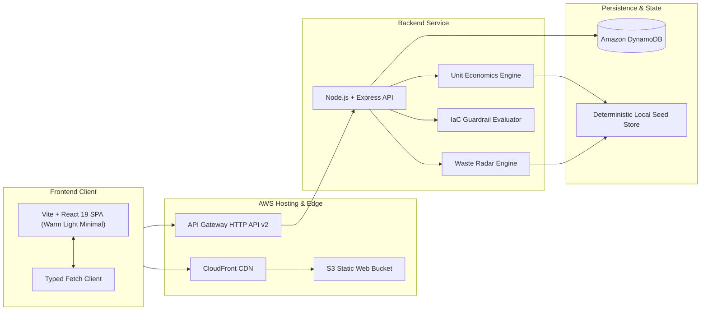

# aws-finos

Cloud Financial Operations and Unit Economics Governance Platform.

`aws-finos` provides automated unit cost analytics, continuous cloud waste triage, and pre-deployment infrastructure-as-code guardrails for engineering teams managing multi-account AWS workloads.

---

## 1. Product Overview

### The Problem
Traditional cloud finance tools produce retrospective monthly reports after bills have already accrued. Engineering teams need proactive controls:
1. Visibility into real-time unit economics (cost per business transaction or active tenant rather than aggregate totals).
2. Continuous scanning for unattached, idle, and abandoned AWS resources.
3. Pre-merge financial guardrails that stop unbudgeted infrastructure changes directly in CI/CD pull requests.

### Core Capabilities
- **Cloud Unit Economics Engine:** Measures infrastructure spend against business throughput (cost per 10k API requests, cost per active tenant, cost per GB processed).
- **Automated Cloud Waste Radar:** Scans for unattached EBS volumes, idle NAT gateways, unassociated Elastic IPs, and idle RDS staging instances with 1-click remediation scripts.
- **Pre-Deployment IaC Guardrails:** Evaluates proposed Terraform and CloudFormation diffs against cost thresholds, mandatory tag policies, and compute instance rules before deployment.
- **Workload Attribution Matrix:** Slices multi-account cloud spend across environments and team domains with real-time burn-rate drift detection (> 20% spike from rolling baseline).

---

## 2. Architecture & Tech Stack



| Layer | Technology | Choice Rationale |
|---|---|---|
| Frontend Framework | React 19 + Vite | Fast startup, clean component model, single-page application |
| Language | TypeScript 5.7 | End-to-end static typing across contracts and UI |
| Styling | Modular CSS custom properties | Warm off-white canvas, Deep Cypress accent, zero bloated UI libraries |
| Typography | Plus Jakarta Sans & JetBrains Mono | Clean, technical, readable typographic hierarchy |
| Backend Runtime | Node.js 20+ with Express | Lightweight, standard REST endpoints, runs locally or inside AWS Lambda |
| Validation | TypeScript type contracts | Runtime schema validation and boundary checks |
| Infrastructure as Code | Terraform (AWS Provider v5.0+) | Declarative definitions for S3, CloudFront, Lambda, API Gateway, and DynamoDB |

---

## 3. Repository Structure

```text
aws-finos/
|-- .gitignore
|-- package.json                     # Monorepo root with dev orchestration
|-- README.md                        # Documentation and difference report
|
|-- apps/
|   |-- web/                         # Frontend Application (Vite + React 19 + TypeScript)
|   |   |-- index.html
|   |   |-- package.json
|   |   |-- tsconfig.json
|   |   |-- vite.config.ts
|   |   \-- src/
|   |       |-- main.tsx             # React mount
|   |       |-- App.tsx              # Root workbench coordinator
|   |       |-- index.css            # Warm-white theme and cypress accent tokens
|   |       |-- api.ts               # Typed client connecting to backend
|   |       \-- components/
|   |           |-- Header.tsx
|   |           |-- Navigation.tsx
|   |           |-- OverviewSummary.tsx
|   |           |-- UnitEconomicsPanel.tsx
|   |           |-- WasteRadarPanel.tsx
|   |           |-- GuardrailCheckPanel.tsx
|   |           \-- AttributionPanel.tsx
|   |
|   \-- api/                         # Backend Application (Node.js + Express + TypeScript)
|       |-- package.json
|       |-- tsconfig.json
|       \-- src/
|           |-- index.ts             # Express server entry point
|           |-- routes.ts            # REST API endpoints
|           \-- mockData.ts          # Deterministic AWS FinOps seed dataset
|
\-- infra/
    \-- terraform/                   # Production AWS Infrastructure as Code
        |-- main.tf                  # S3, CloudFront, Lambda, API Gateway, DynamoDB, IAM
        |-- variables.tf
        |-- outputs.tf
        \-- terraform.tfvars.example
```

---

## 4. Local Quick Start

The platform runs out-of-the-box with pre-seeded, deterministic AWS FinOps telemetry. No AWS credentials or cloud accounts are required for local testing.

### Prerequisites
- Node.js version 20 or higher
- npm version 10 or higher

### Installation & Execution
```bash
# 1. Clone repository and navigate to workspace
cd aws-finos

# 2. Install dependencies across root and workspaces
npm install

# 3. Start both backend API (port 4000) and frontend web app (port 3000) concurrently
npm run dev
```

- Web UI: `http://localhost:3000`
- API Health Check: `http://localhost:4000/health`
- API Overview Endpoint: `http://localhost:4000/api/overview`

---

## 5. Production AWS Deployment

### Infrastructure Topology
The Terraform configuration in `infra/terraform/` provisions:
1. **Amazon S3:** Static web hosting bucket configured for single-page app routing.
2. **Amazon CloudFront:** Global CDN distribution with HTTPS enforcement and edge caching.
3. **AWS Lambda (Node.js 20):** Serverless execution environment for the FinOps API.
4. **Amazon API Gateway (HTTP API v2):** Low-latency, cost-effective API proxy to Lambda.
5. **Amazon DynamoDB:** Pay-per-request table for policy records and triage state.
6. **AWS IAM:** Least-privilege execution roles with read-only Cost Explorer and CloudWatch access.

### Deployment Steps
```bash
# 1. Build frontend and backend production bundles
npm run build

# 2. Navigate to Terraform directory
cd infra/terraform

# 3. Initialize Terraform providers
terraform init

# 4. Review the infrastructure plan
terraform plan

# 5. Apply infrastructure changes
terraform apply
```

### Required AWS IAM Permissions
To deploy and operate `aws-finos`, the deployment identity requires permissions for:
- `s3:CreateBucket`, `s3:PutBucketPolicy`, `s3:PutBucketWebsite`, `s3:PutObject`
- `cloudfront:CreateDistribution`, `cloudfront:GetDistribution`
- `lambda:CreateFunction`, `lambda:GetFunction`, `lambda:UpdateFunctionCode`
- `apigatewayv2:CreateApi`, `apigatewayv2:CreateIntegration`, `apigatewayv2:CreateRoute`, `apigatewayv2:CreateStage`
- `dynamodb:CreateTable`, `dynamodb:DescribeTable`
- `iam:CreateRole`, `iam:PutRolePolicy`, `iam:PassRole`

At runtime, the Lambda execution role utilizes read-only telemetry permissions:
- `ce:GetCostAndUsage`, `ce:GetCostForecast`
- `cloudwatch:GetMetricData`, `cloudwatch:ListMetrics`
- `ec2:DescribeVolumes`, `ec2:DescribeNatGateways`, `ec2:DescribeAddresses`

### Estimated Monthly AWS Hosting Cost
When deployed to AWS, the serverless architecture operates within free-tier thresholds or minimal pay-per-request usage:

| Resource | Usage Model | Estimated Monthly Cost |
|---|---|---|
| S3 Web Storage | < 50 MB static bundle | < $0.05 |
| CloudFront CDN | First 1 TB transfer free | $0.00 |
| Lambda Backend | 256 MB memory, < 100k requests/mo | $0.00 (within free tier) |
| API Gateway HTTP v2 | $1.00 per million requests | < $0.10 |
| DynamoDB Store | Pay-per-request, on-demand | < $0.25 |
| **Total Estimated Hosting Cost** | | **< $1.00 / month** |

---

## 6. Difference Report (Old vs New)

This project preserves only the repository name `aws-finos`. All other components are completely reinvented.

| Dimension | Old Project (`aws-finos`) | New Project (`aws-finos`) | Confirmation |
|---|---|---|---|
| **Domain** | Personal finance, personal bank accounts, UPI tracking, grocery/rent budgeting. | Cloud Financial Operations (FinOps), unit economics, and AWS infrastructure guardrails. | 0% concept reuse. |
| **Features** | Bank statement parser (CSV/PDF delimiter sniffing), personal cash flow ledger, personal savings milestones, Groq merchant classification. | Unit economics engine, automated waste radar (idle EBS/NAT/EIPs), pre-deployment IaC guardrails, workload attribution drift detection. | Entirely new feature set. |
| **User Interface** | Fixed top navbar, dark marketing hero, popup modal dialogs for CRUD inputs, card grids. | Minimal light workbench, horizontal tab navigation, contextual slide-out triage inspector, dense data tables. | 0% UI/UX reuse. |
| **Color Palette** | Deep Navy (`#070d1e`, `#0b1329`), Sky Blue (`#0284c7`, `#0369a1`), Slate (`#f8fafc`). | Warm off-white canvas (`#faf9f5`), Warm ink text (`#191716`), Single accent Deep Cypress Green (`#1b4332`). | Distinct 3-color palette. |
| **Typography** | Default system sans-serif font stack. | Plus Jakarta Sans (body/headings) and JetBrains Mono (identifiers/code). | Different font family. |
| **Frontend Stack** | Next.js 15 App Router with Tailwind CSS v3 and Lucide React. | Vite + React 19 + TypeScript with custom CSS custom properties and zero third-party icon bloat. | Different framework and build tool. |
| **Backend Stack** | Python FastAPI with Uvicorn, SQLite, and Pydantic. | Node.js 20+ with Express, TypeScript, and deterministic mock telemetry engine. | Different runtime and language. |
| **Cloud Hosting & IaC** | None (local SQLite running without any AWS infrastructure code). | Production-ready Terraform provisioning S3, CloudFront, API Gateway, Lambda, and DynamoDB. | Complete IaC included. |
